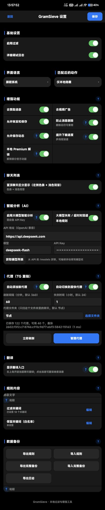

# GramSieve for Conso（Conso 适配版）



> **本项目基于上游 GramSieve 改编，适配 Conso 客户端。**
> 上游：https://github.com/Xposed-Modules-Repo/com.tianqianguai.gramsieve
> 本项目：https://github.com/228983641/gramsieve-conso-mod
> 作者 Telegram 频道：https://t.me/shenlinzhibiao

## 相对上游新增的功能 / Added on top of upstream

- **Conso 适配**：支持 Conso 客户端（`global.xfinite.conso`），同时兼容官方 Telegram（`org.telegram.messenger`）
- **增强功能**：去赞助消息、去视频广告、允许转发和保存、允许保存动态、防止消息删除、提升下载速度、本地 Premium 解锁（仅客户端生效）
- **智能分析并屏蔽**：长按消息分析正文/说明/按钮文字，提取关键词、域名、@用户名、IP 等，确认后加入规则；可接大模型作补充建议
- **TG 代理管理**：扫描指定文件夹的代理链接，自动添加、自动切换到最快代理，测速与联通检查，按延迟排序
- **自动翻译**：外文消息自动翻译为简体中文，走 Conso 自带翻译服务，不经过第三方翻译网站
- **中文卡片式设置面板**：规则用“、”分隔，外部只显示关键词个数不直接显示内容；聊天列表置顶区分显示；数据备份（导出/导入规则与完整备份、导出日志）
- **开源与社区**：设置面板最下方有本项目开源地址、上游地址和作者 Telegram 频道入口

> **本项目是上游 GramSieve 的 Conso 适配分支，不是上游官方发布，也与 Telegram、Conso 官方无关。**
> This is a Conso adaptation fork of upstream GramSieve, not an upstream release, and not affiliated with Telegram or Conso.

## 这是什么 / What it is

一个 LSPosed / Xposed 模块（libxposed API 101），让 Conso Telegram 客户端（包名 `global.xfinite.conso`，同时兼容官方 Telegram `org.telegram.messenger`）获得：

- 消息过滤（关键词 / 正则，白名单优先，本地隐藏 / 折叠 / 调试标记）
- 防撤回与编辑历史、主动加载、消息标记与跳转
- 长按消息的屏蔽、标记与“智能分析并屏蔽”
- 去赞助消息、去视频广告、允许转发和保存、允许保存动态、防止消息删除、提升下载速度
- 本地 Premium 解锁（仅客户端生效，见下）
- 外文消息自动翻译为简体中文（走 Conso 自带翻译服务，不经过第三方翻译网站）
- 中文设置界面，美化后的卡片式面板，简化的规则编辑界面

过滤本身在本地执行，不上传你的消息；翻译、主动加载、媒体下载会使用网络（翻译走 Telegram 服务端）。

Filtering itself runs locally and does not upload your messages. Translation, proactive loading and media downloads use the network (translation uses Telegram's own service).

## 适用与要求 / Requirements

- Android + LSPosed（支持 libxposed API 101）
- Conso 2.0.0 已在静态分析中验证（`ChatActivity.createMenu` 等关键类存在）；其他 Conso 版本未验证，部分 UI 钩子可能静默失效
- 在 LSPosed 中**只给 Conso 启用**（不要勾选系统框架），装好后强制停止 Conso 再重新打开
- 设置入口：Conso 设置 → GramSieve；聊天右上角菜单 → 聊天过滤规则；长按消息 → 屏蔽 / 标记 / 智能分析并屏蔽

## 功能与效果 / Features and effects

### 1. 消息过滤

- 全局规则 + 单聊规则：全局设宽泛规则，再针对特定聊天覆盖或排除
- 匹配目标：消息文字、媒体说明、内联按钮文字 / 链接、发送者名称 / ID、聊天名称 / ID、全字段
- 匹配方式：关键词（每行一条）或正则；保留（白名单）规则始终优先于过滤规则
- 匹配后动作：仅本地隐藏、仅本地折叠、调试标记（测试用）
- 效果：命中规则的消息在你的设备上被隐藏或折叠，不影响对方和其他设备；白名单消息（如管理员、公告）不会被误拦

### 2. 智能分析并屏蔽（长按消息）

- 长按一条消息 → “智能分析并屏蔽”，分析正文、说明、按钮、发送者
- 提取：赌博等强信号词、域名、t.me 链接、@ 用户名、中文品牌词（如 122体育、N1国际）、IP 落地页（只存 IP，不存端口）
- 对话框顶部先显示“分析出的关键词：……”再加其他标识，下面是多选列表；强信号默认勾选，体育 / 电子 / 红包这类通用词默认不勾
- 确认后加入**全局规则**，对所有聊天生效；词被 emoji、空格、标点拆开（如“百🤩家乐”“百 家 乐”）也能识别
- 效果：一条广告点一次，就能把同类广告的关键词、域名、发送者一次性拦住，而不是只拦这一条原样消息

### 3. 防撤回、编辑历史、标记

- 主动加载 / 防撤回：后台缓存已收到的消息，撤回后仍可在本地查看（只能保留实际收到并成功缓存的内容，开启设置不会补回已经消失的记录）
- 编辑历史：有编辑记录的消息可在长按菜单查看历史版本
- 标记 / 跳转：标记一条消息后可在聊天菜单里跳转到标记、回到顶部
- 效果：对方撤回、编辑后，你仍能看到原始内容和变化

### 4. 增强功能（设置 → GramSieve → 增强功能，默认全部关闭）

| 分类 | 开关 | 效果 |
| --- | --- | --- |
| 广告 | 去赞助消息 | 不再插入频道 / 聊天里的赞助消息 |
| 广告 | 去视频广告 | 跳过视频广告加载 |
| 消息 | 允许转发和保存 | 在禁止转发的聊天里也能转发和保存 |
| 消息 | 防止消息删除 | 直接拦下服务端的删除更新，与防撤回是两套机制，可同时开 |
| 动态 | 允许保存动态 | 允许动态截图、启用已有的保存菜单项（简化移植：若 Conso 动态菜单里本来就没有保存项，单开此开关不起作用） |
| 性能 | 提升下载速度 | 只改客户端下载并行度（大文件分块 512 KiB、并行 8 路）；服务端限速仍在 |
| 本地 Premium | 本地 Premium 解锁 | 仅本地生效：让客户端认为你是 Premium，可突破置顶聊天数等客户端检查 |

### 5. 本地 Premium 的诚实说明（必读）

- 本地 Premium 只改客户端判断（`UserConfig.isPremium()` 等返回 true），**不是真的 Premium 订阅**
- 服务端 Premium 功能（大文件上传、语音转文字等）仍需官方订阅
- 置顶超过 5 个聊天：如果服务端直接拒绝第 6 个置顶（服务端知道账号不是真 Premium），客户端再怎么放开也强求不来；这时不是设置没开，是服务端限制
- 开启本地 Premium 有封号风险，请自行决定

### 6. 自动翻译为简体中文（设置 → GramSieve → 翻译，默认关闭）

- 使用 Conso 自带的 `TranslateController`，不经过第三方翻译网站
- 开启后，打开聊天时自动把该聊天的翻译目标设为简体中文（zh-CN，优先于泛 zh / 繁体），并尝试开启整聊自动翻译
- 整聊自动翻译在宿主里是 Premium 功能，若未自动翻译，请同时开启“增强功能”里的本地 Premium，或点聊天顶部的翻译按钮手动翻译整聊
- 翻译由 Telegram 服务端完成，首次打开聊天、消息多时需要几秒到十几秒，属正常；若长时间不翻，退出重进该聊天再试一次
- 中文消息不受影响

### 7. 设置界面

- 全部中文界面，跟随 Conso 主题（亮 / 暗）
- 卡片式面板：全局配置、增强功能、翻译、规则内容
- 规则内容已简化：默认只显示“过滤关键词（消息文字）”和“保留关键词（白名单）”两个框；“显示高级规则”开关展开后才显示正则，以及媒体说明、按钮、发送者、聊天、全字段的规则；收起时高级规则照常保存，不会丢失
- 效果：日常只填两个框就够用，不用面对原来 24 个输入框

## 聊天列表 / Chat list

- 置顶区分（设置 → GramSieve → 聊天列表，默认关闭）：置顶聊天左侧有一条主题蓝的色条，并带一层浅色背景，非置顶没有；只影响外观，不改置顶本身。
- 自动分类栏（同上，默认关闭）：文件夹栏下方出现独立的“全部 / 个人 / 群聊 / 频道”栏，与文件夹分开；点个人只看个人聊天（含机器人），点群聊只看普通群与超级群，点频道只看广播频道，点全部恢复；分类栏关闭后筛选即失效。

## 版本区分 / Version identity

- 本适配的包名与上游相同（`com.tianqianguai.gramsieve`），但版本名带 `-conso` 后缀、应用名显示为 GramSieve Conso、版本号高于上游官方版，因此上游官方包不会被系统当作本适配的“更新”；反之，本适配也不会覆盖上游官方包的安装（签名不同，仍需先卸载其一）。

## 界面截图 / Screenshots

> 真机截图待补充：下面是占位，待从已安装本模块的设备上截取真实界面后替换。
> Real device screenshots are pending: placeholders below, to be replaced with screenshots taken on a device running this module.

| 界面 | 截图 |
| --- | --- |
| 设置 → GramSieve（全局配置、增强功能、翻译） | `docs/screenshots/settings-global.jpg`（见本页顶部） |
| 规则内容（简化后，默认只显示两个框） | `docs/screenshots/rules-simple.png`（待补充） |
| 规则内容（展开高级规则） | `docs/screenshots/rules-advanced.png`（待补充） |
| 长按消息 → 智能分析并屏蔽（顶部显示分析出的关键词） | `docs/screenshots/smart-block.png`（待补充） |
| 聊天顶部翻译按钮 / 自动翻译效果 | `docs/screenshots/translate.png`（待补充） |
| 增强功能卡片（广告 / 消息 / 动态 / 性能 / 本地 Premium 分类） | `docs/screenshots/enhancements.png`（待补充） |

如需补充截图：请在 Conso 里打开对应界面截图（注意打码私人聊天内容、账号、手机号），发给维护者后替换上表占位。

## 安装 / Install

1. 安装本模块 APK（见 Releases，或自行构建，见下）
2. 在 LSPosed 中启用本模块，作用域**只选 Conso**（以及需要时选官方 Telegram）
3. 强制停止 Conso，重新打开
4. Conso 设置 → GramSieve，按需开启开关并保存；规则在“规则内容”里填，关键词用“、”分隔，点“编辑”进关键词编辑界面（外部只显示个数，不直接显示关键词）
5. 首次安装或签名变更时需要卸载旧版再装；同签名系列的后续版本可直接覆盖安装（见“签名”）

## 自行构建 / Build

```bash
./gradlew assembleRelease
# 产物：app/build/outputs/apk/release/app-release.apk
```

或用本仓库的 GitHub Actions（`Build` 工作流，手动触发，产物名 `GramSieve-conso`）。

构建要求：Java 17、Android SDK 36、Gradle 9.3.1（见工作流）。

## 签名 / Signing

- 私有开发阶段曾用一个固定的调试密钥（`debug.keystore.b64`，标准 Android 调试密钥，密码 `android`），以保证同一系列版本可覆盖安装；公开前该文件已从当前版本删除，工作流不再使用它
- 公开版签名：发布密钥只存放在 GitHub Actions Secrets 里（`RELEASE_KEYSTORE_BASE64`、`RELEASE_STORE_PASSWORD`、`RELEASE_KEY_ALIAS`、`RELEASE_KEY_PASSWORD`），工作流构建时临时还原为 `release.keystore`，用完即弃，仓库里只有 Secret 引用名，没有密钥内容；构建配置见 `app/build.gradle.kts` 的 release 签名段
- 公开后的首个版本签名与私有阶段不同，需要卸载旧版再装一次；之后同一把 Secret 密钥的版本可直接覆盖安装
- 注意：旧调试密钥仍留在公开前的 git 历史里，只能用于旧版，不能用于新版；切勿把正式发布密钥、账号密码、Token 提交到仓库

## 风险与免责 / Risks and disclaimer

- 本模块修改 Telegram 客户端行为，可能违反 Telegram 服务条款，存在账号受限、封号风险，尤其是本地 Premium；请自行决定，自担风险
- 过滤、防撤回等均为本地效果，不影响对方和其他设备；服务端删除、服务端限制无法靠客户端完全绕过
- 本项目与 Telegram、Conso 官方无关；Conso 的商标、客户端本体归其权利人所有
- 本项目按 GPL-3.0-or-later 开源，见 `LICENSE`；使用、修改、分发须遵守该许可证，并保留上游与移植来源的署名

## 来源与致谢 / Credits

- 上游 GramSieve（`Xposed-Modules-Repo/com.tianqianguai.gramsieve`，GPL-3.0-or-later，主分支提交 97bf94a）：过滤、防撤回、标记、主动加载等核心逻辑
- NoAdsTelegram（`igormsc/ai.noads.NoAdsTelegram`）：去赞助、去视频广告、转发保存、保存动态、防删除等钩子思路（已按 libxposed 改写，不是原样粘贴）
- TeleVip：下载提速（大文件分块、并行）、本地 Premium 思路
- Conso 适配、中文界面、智能分析、翻译、增强功能分类设置、规则界面简化：本分支

## 详细变更记录 / Changelog

见 `README_CONSO.md`（按构建记录的中文变更说明，含每次构建的提交、运行号、核对结果与已知限制）。

## 许可证 / License

GPL-3.0-or-later，见 `LICENSE` 文件。
